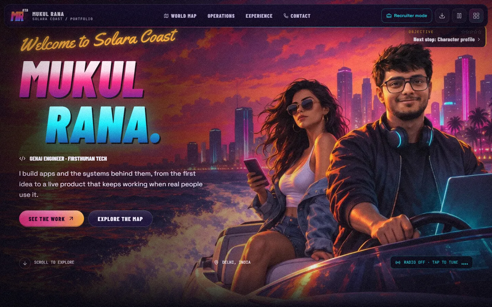
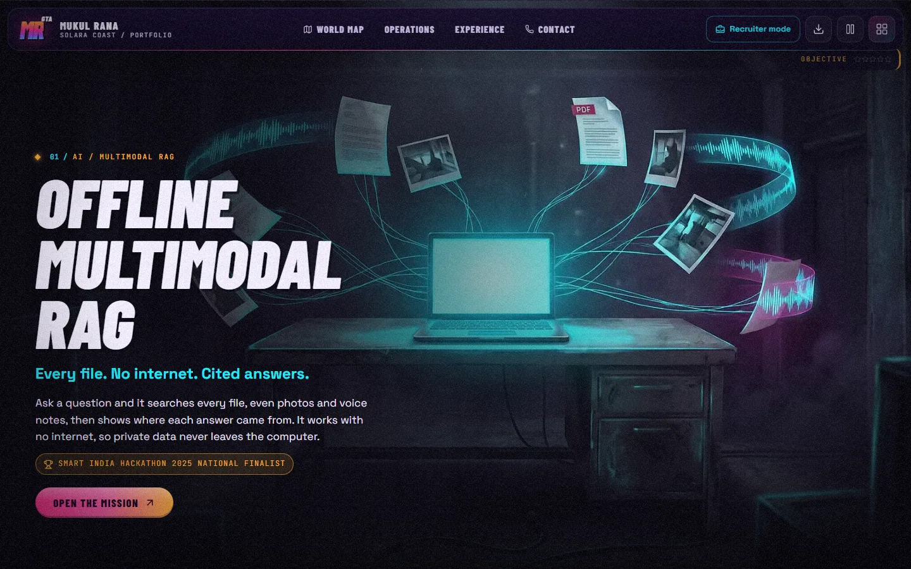
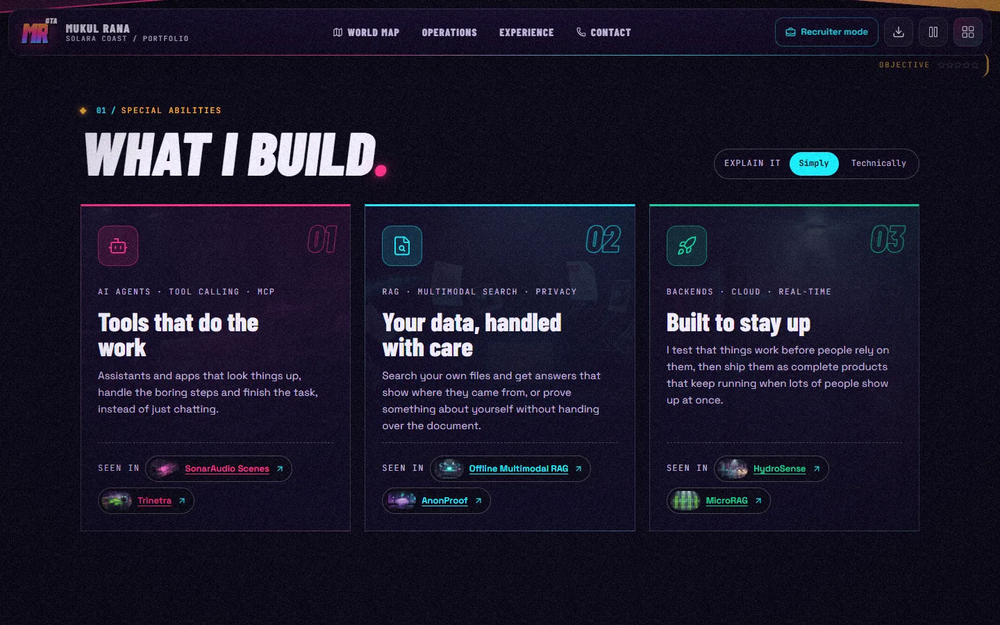
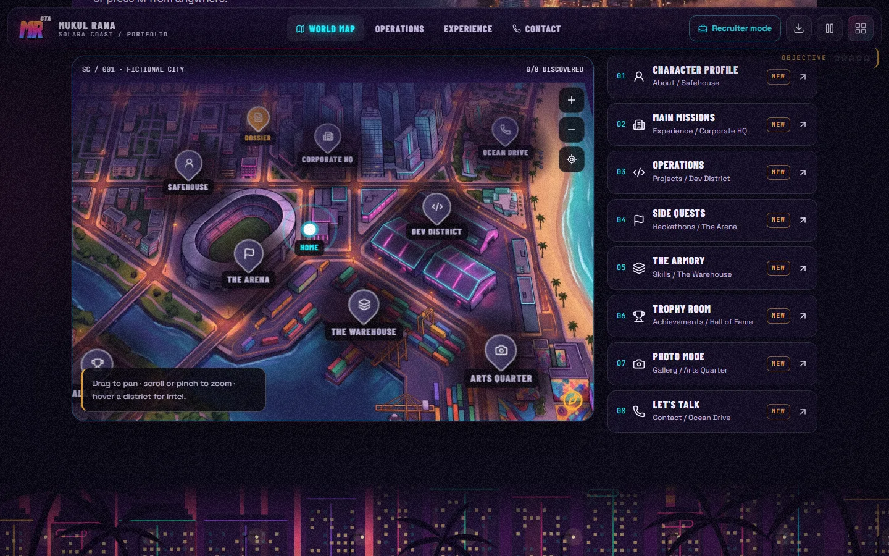
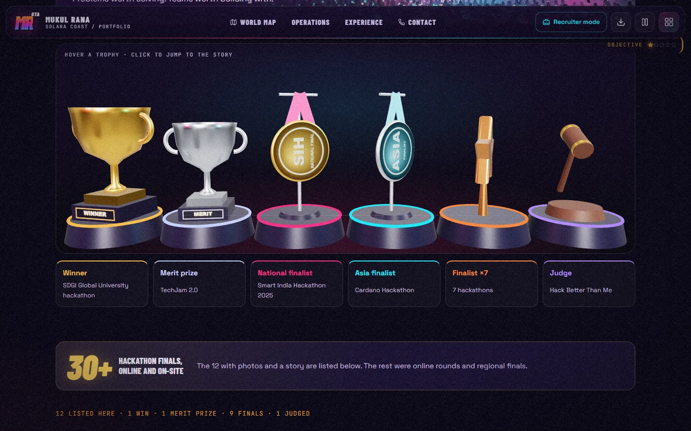
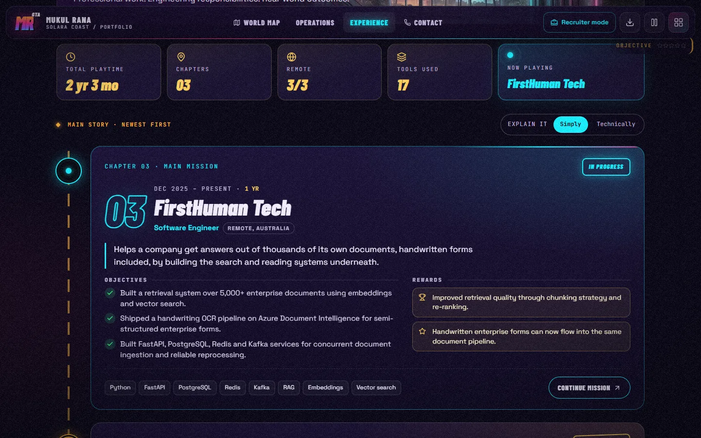
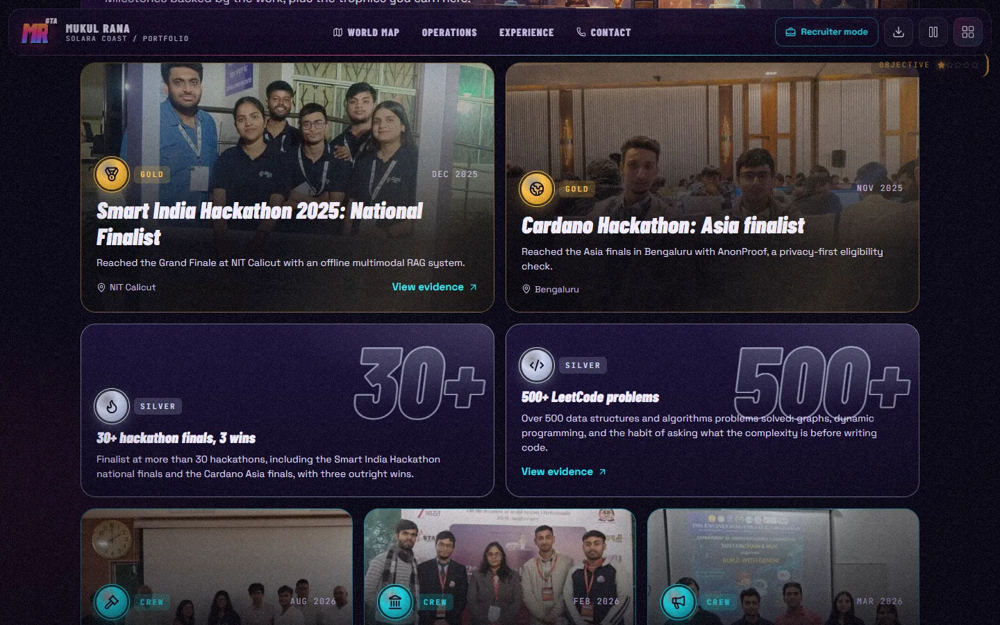
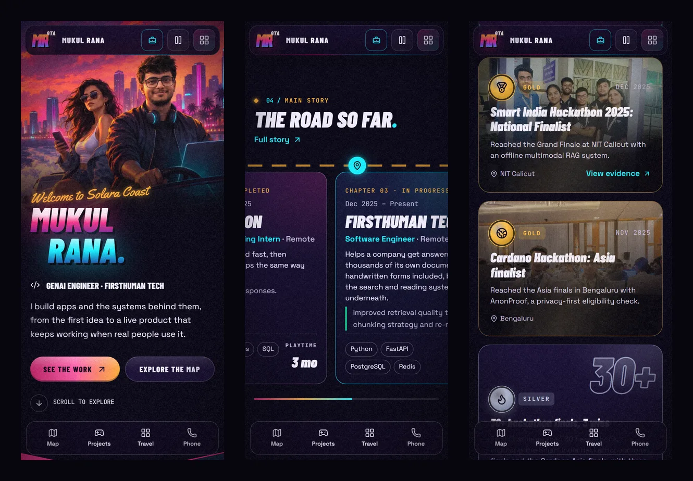
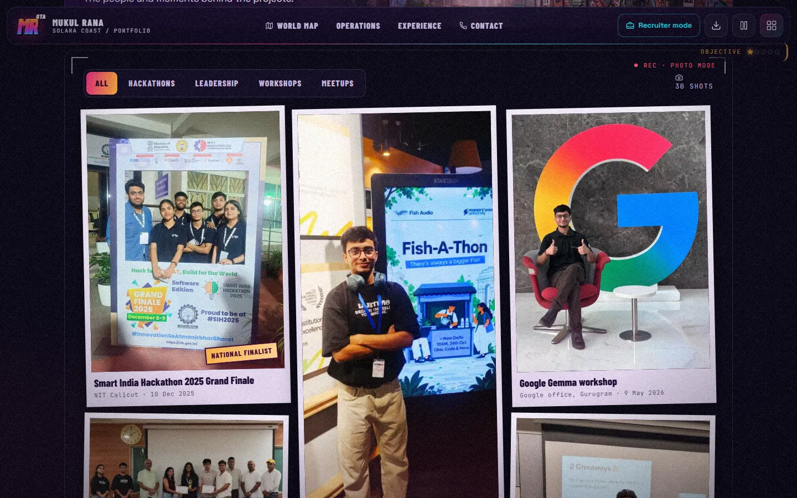

<div align="center">

# Mukul Rana // Solara Coast

**A developer portfolio you play.** An original open-world, neon-sunset game UI built on Next.js 16, with a one-click Recruiter mode for people who just want the facts.

[Live site](https://gta-vi-portfolio.vercel.app/) · [Docs](docs/README.md) · [Portfolio builder skill](skills/portfolio-builder/README.md) · [Learn how it's built](docs/learning/README.md)

</div>

---

## Screenshots



| | |
| --- | --- |
|  |  |
| **Project scenes**: the three big jobs pin full-screen as you scroll | **What I build**: plain or technical, with the projects behind each |
|  |  |
| **World map**: tilted 3D plane, pins rise in, camera flies to districts | **Hackathons**: a three.js trophy shelf built in code |
|  |  |
| **Experience**: each role as a mission file on a road | **Achievements**: ranked trophy wall and verified certifications |





## What it is

Every page is a district on a map of a fictional city. Projects are *operations*, roles are *mission files* on a road, skills are an *armory*, awards hang on a *trophy wall*. A boot screen, HUD, minimap, toasts, pause menu, quick-travel wheel and painted scenery make it feel like a game, while every word stays a real, checkable fact about the work.

- **Two modes.** Game mode (default) and Recruiter mode: same content, no effects, plain navigation.
- **Explain it simply or technically.** Every project has a one-line plain-English version and a technical one; one toggle swaps them site-wide.
- **Fast and accessible.** Static pages, Lighthouse mobile 91–92 performance and 100 accessibility / best practices / SEO (see [deployment](docs/deployment.md#speed-2026-11-14)); axe accessibility scans in the tests; respects reduced motion.
- **Content is data.** Everything lives in typed files under `web/content/`; media is picked up from folders.

## Quick start

```sh
cd web
npm ci
npm run dev          # http://localhost:3000
```

Node 20.9+. Before deploying: `npm run verify` (lint, types, build, Playwright).

## Repository layout

```
.
├── web/                    the Next.js app (see web/README.md)
├── docs/                   project structure, content editing, deployment, learning guides
├── skills/portfolio-builder/  reusable Claude skill: build a themed portfolio in any theme
├── art-raw/                full-size generated art (input to `npm run art`, never deployed)
└── media/                  original event photos (source for web/public/gallery)
```

## Tech

Next.js 16 (App Router, Turbopack) · React 19 (View Transitions) · TypeScript strict · hand-written CSS with design tokens + Tailwind 4 theme bridge · `next/font`, `next/image` · Lucide icons · Lenis smooth scroll · three.js (trophy shelf, lazy-loaded) and raw WebGL shaders (hero depth, poster ripple) · Web Audio synth (opt-in) · Playwright + axe.

## Docs

| | |
| --- | --- |
| [Project structure](docs/project-structure.md) | Where pages, components, styles and animations live |
| [Editing content](docs/content-editing.md) | Change bio, projects, roles, skills, photos, screenshots |
| [Checks and deployment](docs/deployment.md) | Tests, speed numbers, going live |
| [Learning guide](docs/learning/README.md) | The frontend concepts used here, including the footer car animation |

## Originality

"Solara Coast", its districts, radio stations, scenes and art are original. The site is inspired by the open-world crime-game genre but uses no Rockstar or GTA logos, art, fonts, characters, screenshots or trademarked names.

## License

Code: all rights reserved unless a license file is added. Personal content (bio, photos, resume) belongs to Mukul Rana and is not licensed for reuse.
